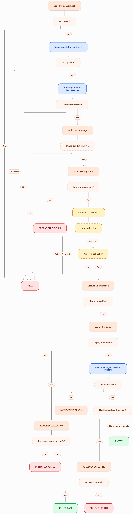

# Event-Driven Agentic Pipeline

Structural Architecture Design | Enterprise Microservice Production Deployment | Week 10 Activity

## 1. Architecture Overview

### 1.1 System Objective

The proposed Event-Driven Agentic Deployment Pipeline automates the progression from code submission to production deployment and post-deployment monitoring through three specialized agents.

The architecture combines:

- Event-driven execution: Each stage activates through a defined event or state transition.
- Agentic decision-making: Agents analyze test results, build output, migration information, and runtime telemetry.
- Deterministic orchestration: Explicit conditions control whether the workflow advances, pauses, fails, or rolls back.
- Human-in-the-loop (HITL): Production database migration requires an authorized person's approval.
- Controlled recovery: Failures terminate the workflow or initiate a bounded rollback process rather than unlimited retries.

### 1.2 High-Level Architecture

Code Push / Webhook Event

Repository, commit SHA, branch, service

AGENT 1

Guard-Agent

Unit tests → Parse output → Pass / Fail decision

Tests passed

AGENT 2

Infra-Agent

Dependencies → Docker build → Migration assessment

Mandatory Human Approval Gate

Approve or reject production database migration

Workflow paused

Infra-Agent resumes

Execute approved migration → Deploy container → Verify readiness

AGENT 3

Watchman-Agent

Runtime logs → HTTP error rates → Anomaly detection

SUCCESS

Stable deployment

ROLLBACK

Threshold breached

Failure branches at earlier stages terminate or enter controlled recovery. Only successful validation permits progression.

### 1.3 Architectural Components

| Component              | Function                                                               |
| ---------------------- | ---------------------------------------------------------------------- |
| Event source           | Git repository webhook indicating a new commit                         |
| Workflow orchestrator  | Maintains state, invokes agents, evaluates transitions, handles pauses |
| Guard-Agent            | Validates code through unit testing                                    |
| Infra-Agent            | Builds, prepares migrations, and deploys                               |
| Approval interface     | Allows an authorized human to approve or reject production migration   |
| Watchman-Agent         | Evaluates post-deployment health and initiates rollback                |
| Shared state store     | Persists workflow results, artifacts, and decisions                    |
| Artifact registry      | Stores versioned Docker images                                         |
| Log and metrics source | Supplies runtime telemetry for health evaluation                       |

The workflow orchestrator is not a fourth agent. It is the deterministic state machine responsible for routing the three required agents.

Similarly, the human approval gate, Docker registry, and monitoring infrastructure are supporting system components, not autonomous agents.

## 2. Shared Workflow State

### 2.1 Purpose

All three agents operate on a shared workflow state object.

This object serves as the single source of truth for execution status, handoff information, approvals, and recovery decisions.

For this activity, a persisted structured JSON-like state is sufficient. The design does not require a complex distributed event platform.

### 2.2 Proposed State Schema

| State field           | Description                                 | Initial value            |
| --------------------- | ------------------------------------------- | ------------------------ |
| `workflow_id`         | Unique pipeline execution identifier        | Generated                |
| `service_name`        | Target microservice                         | From webhook             |
| `commit_sha`          | Exact source revision                       | From webhook             |
| `branch`              | Source branch                               | From webhook             |
| `environment`         | Deployment environment                      | `production`             |
| `current_state`       | Current deterministic execution state       | `EVENT_RECEIVED`         |
| `test_status`         | Unit test result                            | `PENDING`                |
| `test_summary`        | Parsed test counts and failures             | `null`                   |
| `dependency_status`   | Dependency preparation result               | `PENDING`                |
| `docker_build_status` | Docker build outcome                        | `PENDING`                |
| `image_digest`        | Immutable Docker image identifier           | `null`                   |
| `migration_status`    | Database migration outcome                  | `PENDING`                |
| `migration_risk`      | Determined migration risk classification    | `UNKNOWN`                |
| `approval_status`     | Human decision                              | `NOT_REQUESTED`          |
| `approval_record`     | Reviewer, time, approved change reference   | `null`                   |
| `deployment_status`   | Container deployment outcome                | `PENDING`                |
| `previous_version`    | Last verified healthy deployment identifier | From deployment platform |
| `monitoring_status`   | Post-deployment health verdict              | `PENDING`                |
| `http_error_rate`     | Measured server error percentage            | `null`                   |
| `rollback_status`     | Recovery outcome                            | `NOT_REQUIRED`           |
| `retry_count`         | Retry attempts for bounded operations       | `0`                      |
| `error_details`       | Structured failure information              | `null`                   |
| `audit_log`           | Timestamped transitions and decisions       | Empty collection         |

### 2.3 State Management Rules

The following rules prevent inconsistent execution:

1. Each state transition must have a valid predecessor and a recorded outcome.
2. Agents may update their assigned operational results but cannot override human approvals.
3. Missing or ambiguous evidence is never interpreted as a successful operation.
4. Test results, image identifiers, migration records, and deployment status must belong to the same workflow execution.
5. Every terminal workflow must end in a recorded success, failure, or rollback outcome.

For example, `test_status = PASSED` is only valid when the unit-test process exits successfully and the expected test report is available and valid.

A generated agent summary alone is insufficient evidence of success.

## 3. Guard-Agent

### 3.1 Primary Responsibility

The Guard-Agent serves as the pipeline's quality-control gatekeeper.

It validates a new code revision before allowing any infrastructure build or deployment activity.

### 3.2 Agent Specification

| Property         | Definition                                                                           |
| ---------------- | ------------------------------------------------------------------------------------ |
| Trigger          | Valid code push or webhook event                                                     |
| Input state      | `EVENT_RECEIVED`                                                                     |
| Required input   | Repository, branch, commit SHA, service name                                         |
| Responsibilities | Trigger unit tests, capture console logs, parse results, classify success or failure |
| Output state     | `TEST_PASSED`, `TEST_FAILED`, or `TEST_ERROR`                                        |
| Next agent       | Infra-Agent, only on verified test success                                           |

### 3.3 Internal Execution Sequence

Receive and validate webhook

Check out exact commit and execute unit tests

Capture exit code, raw logs and structured test report

Are all required tests passing?

YES

TEST_PASSED

Handoff to Infra-Agent

NO / ERROR

TEST_FAILED / TEST_ERROR

Terminal failure

### 3.4 Decision Points

Decision A: Is the incoming event valid?

The event must pass webhook signature validation, match an allowed repository and branch, and identify a resolvable commit. Invalid events are rejected without initiating tests.

Decision B: Did the test command execute successfully?

A missing test runner, process timeout, or execution error produces `TEST_ERROR`, not `TEST_PASSED`.

Decision C: Did all required tests pass?

A successful verdict requires a zero exit code and a valid test report with no failed required tests. Missing, incomplete, or contradictory results must fail closed.

An agent may explain or summarize console output using reasoning capabilities, but the actual routing condition remains based on verifiable test evidence.

### 3.5 Success Path

`EVENT_RECEIVED → TEST_RUNNING → TEST_PASSED → Infra-Agent`

### 3.6 Failure Path

`EVENT_RECEIVED → TEST_RUNNING → TEST_FAILED / TEST_ERROR → FAILED`

No Docker build, database migration, or deployment is permitted.

### 3.7 Data Passed Forward

On verified success, Guard-Agent updates the shared state with:

- `commit_sha`
- `test_status = PASSED`
- Number of executed and passed tests
- Test execution timestamp
- Test report and log artifact references
- Validated source revision

## 4. Infra-Agent

### 4.1 Primary Responsibility

The Infra-Agent manages the infrastructure preparation and production release lifecycle.

It is activated only when Guard-Agent has produced a verified passing test result.

### 4.2 Agent Specification

| Property         | Definition                                                                                                                           |
| ---------------- | ------------------------------------------------------------------------------------------------------------------------------------ |
| Trigger          | `TEST_PASSED`                                                                                                                        |
| Input state      | `INFRA_PENDING`                                                                                                                      |
| Required input   | Validated commit, successful test record, build configuration                                                                        |
| Responsibilities | Prepare dependencies, build Docker image, assess migrations, request approval, execute migration, deploy container, verify readiness |
| Output state     | `DEPLOYED`, a defined failure state, or `APPROVAL_PENDING`                                                                           |
| Next agent       | Watchman-Agent, only after successful deployment and readiness verification                                                          |

### 4.3 Internal Execution Sequence

1. Verify the test-passing commit and obtain the deployment configuration.
2. Restore or build application dependencies.
3. Build the Docker image and capture its immutable digest.
4. Generate and inspect the pending Entity Framework (EF) or Structured Query Language (SQL) migration plan.
5. Classify migration risk and prepare supporting information for human review.
6. Pause in `APPROVAL_PENDING` before any production migration is executed.
7. Following explicit approval, revalidate the approved migration and target environment, then execute the migration.
8. Deploy the approved Docker image and perform readiness verification.
9. Transfer deployment metadata to Watchman-Agent.

### 4.4 Critical Decision Points

| Decision                   | Success condition                                             | Failure behavior                                 |
| -------------------------- | ------------------------------------------------------------- | ------------------------------------------------ |
| Valid Guard handoff?       | Test status verified as `PASSED` for the same commit          | Stop                                             |
| Dependencies built?        | Build command and dependency validation succeed               | `BUILD_FAILED`                                   |
| Docker image built?        | Build exits successfully and image digest exists              | `BUILD_FAILED`                                   |
| Migration safe to propose? | Plan, database target, risk, and recovery strategy documented | `MIGRATION_BLOCKED` if unsafe or unverifiable    |
| Human approved?            | Valid approval for exact migration version                    | Otherwise remain paused or terminate             |
| Migration succeeded?       | Execution succeeds and expected schema version is verified    | `MIGRATION_FAILED`, initiate controlled recovery |
| Deployment succeeded?      | Expected image is running and readiness passes                | `DEPLOYMENT_FAILED`, initiate recovery           |

### 4.5 Migration Risk Evaluation

The Infra-Agent can classify migrations using a simple rule-based model:

| Risk level | Example                                                              | Required action                                                                       |
| ---------- | -------------------------------------------------------------------- | ------------------------------------------------------------------------------------- |
| Low        | Add a nullable column                                                | Human approval still mandatory                                                        |
| Medium     | Add a constrained index or backfill                                  | Human approval plus operational checks                                                |
| High       | Drop columns, destructive transformations, irreversible data changes | Block until redesigned or supplied with a separately reviewed, feasible recovery plan |

Important: Even low-risk migration proposals do not bypass the human approval requirement.

The Infra-Agent must not automatically execute a destructive or unverifiable migration simply because the deployment pipeline has reached that state.

### 4.6 Success Path

`TEST_PASSED → DEPENDENCIES_READY → IMAGE_BUILT → MIGRATION_ASSESSED → APPROVAL_PENDING → APPROVED → MIGRATED → DEPLOYED`

### 4.7 Failure Path

Failures before production mutation lead directly to terminal failure.

Failures after migration or deployment may initiate controlled recovery.

For example:

`IMAGE_BUILT → MIGRATION_ASSESSED → APPROVAL_REJECTED → FAILED`

or:

`MIGRATED → DEPLOYMENT_FAILED → ROLLBACK_PENDING`

### 4.8 Data Passed to Watchman-Agent

- `workflow_id`
- `service_name`
- `commit_sha`
- `image_digest`
- `deployment_id`
- `deployment_status = DEPLOYED`
- `migration_status = SUCCESS`
- `previous_version`
- Target environment and monitoring endpoint
- Deployment and monitoring start timestamps
- Rollback target and recovery strategy

## 5. Watchman-Agent

### 5.1 Primary Responsibility

The Watchman-Agent evaluates the health of a newly deployed service and determines whether it can remain in production.

It operates only after Infra-Agent reports a successful deployment and readiness verification.

### 5.2 Agent Specification

| Property         | Definition                                                                          |
| ---------------- | ----------------------------------------------------------------------------------- |
| Trigger          | `DEPLOYED`                                                                          |
| Input state      | `MONITORING_ACTIVE`                                                                 |
| Required input   | Deployment ID, service metrics, live logs, monitoring configuration                 |
| Responsibilities | Collect telemetry, calculate error rates, detect anomalies, evaluate rollback rules |
| Output state     | `MONITORING_PASSED`, `ROLLBACK_REQUIRED`, or `MONITORING_ERROR`                     |
| Success path     | Stable service → `SUCCESS`                                                          |
| Failure path     | Threshold breach → controlled rollback                                              |
| Data persisted   | HTTP error rates, anomaly evidence, verdict, recovery outcome                       |

### 5.3 Monitoring Signals

For the Week 10 prototype, three signals are sufficient.

| Signal              | Example condition                                 | Response         |
| ------------------- | ------------------------------------------------- | ---------------- |
| HTTP 5xx error rate | Exceeds 5% over a 5-minute observation window     | Trigger rollback |
| Runtime exceptions  | Critical process crashes or restart-loop evidence | Trigger rollback |
| Service readiness   | Required health endpoint repeatedly fails         | Trigger rollback |

The 5% threshold is an illustrative student-project configuration, not an industry-wide standard.

HTTP error rate is calculated as:

\\[ \text{Error Rate}=\frac{\text{HTTP 5xx Responses}}{\text{Total HTTP Responses}}\times100 \\]

A minimum request sample and an explicit observation interval must be configured to reduce false alarms. No traffic, missing metrics, or unavailable logs must produce an inconclusive or monitoring-error verdict rather than a fabricated healthy result.

### 5.4 Decision Points

Decision A: Is runtime telemetry available?

If logs or metrics are unavailable, monitoring must not automatically pass.

Decision B: Are any critical conditions violated?

If a configured critical condition is violated, Watchman-Agent requests rollback.

Decision C: Has the deployment completed its observation window without violations?

If valid monitoring data confirms acceptable operation throughout the configured window, Watchman-Agent reports success.

For an educational demonstration, a finite 5-minute observation window is appropriate. Continuous monitoring may exist separately in production, but this particular workflow execution must terminate.

### 5.5 Success Path

`DEPLOYED → MONITORING_ACTIVE → MONITORING_PASSED → SUCCESS`

### 5.6 Failure Path

`DEPLOYED → MONITORING_ACTIVE → ROLLBACK_REQUIRED → ROLLBACK_EXECUTING`

If monitoring is unavailable, the workflow enters `MONITORING_ERROR` and follows a predefined conservative recovery policy, rather than asserting success.

### 5.7 Output State Data

Watchman-Agent records:

- Deployment version and observation window
- Total HTTP requests and HTTP 5xx responses
- Calculated HTTP error rate
- Relevant exception and health-check evidence
- Monitoring verdict
- Threshold rule violated, if any
- Rollback request and outcome, if applicable

## 6. Conditional Routing Logic

Routing is controlled by explicit conditions evaluated against the shared workflow state.

### 6.1 Routing Table

| Current state          | Condition                                            | Next state             |
| ---------------------- | ---------------------------------------------------- | ---------------------- |
| `EVENT_RECEIVED`       | Valid webhook                                        | `TEST_RUNNING`         |
| `EVENT_RECEIVED`       | Invalid webhook                                      | `FAILED`               |
| `TEST_RUNNING`         | Tests verified passing                               | `INFRA_PENDING`        |
| `TEST_RUNNING`         | Tests fail or results invalid                        | `FAILED`               |
| `INFRA_PENDING`        | Dependencies ready                                   | `DOCKER_BUILDING`      |
| `INFRA_PENDING`        | Dependency failure                                   | `FAILED`               |
| `DOCKER_BUILDING`      | Docker build successful                              | `MIGRATION_ASSESSMENT` |
| `DOCKER_BUILDING`      | Docker build failed                                  | `FAILED`               |
| `MIGRATION_ASSESSMENT` | Migration plan reviewable and permitted for approval | `APPROVAL_PENDING`     |
| `MIGRATION_ASSESSMENT` | Unsafe or unverifiable migration                     | `MIGRATION_BLOCKED`    |
| `APPROVAL_PENDING`     | Authorized approval                                  | `MIGRATION_EXECUTING`  |
| `APPROVAL_PENDING`     | Rejected or expired                                  | `FAILED`               |
| `MIGRATION_EXECUTING`  | Schema migration verified                            | `DEPLOYING`            |
| `MIGRATION_EXECUTING`  | Migration failed                                     | `RECOVERY_EVALUATION`  |
| `DEPLOYING`            | Deployment and readiness verified                    | `MONITORING_ACTIVE`    |
| `DEPLOYING`            | Deployment failed                                    | `RECOVERY_EVALUATION`  |
| `MONITORING_ACTIVE`    | Stable for defined window                            | `SUCCESS`              |
| `MONITORING_ACTIVE`    | Critical threshold breached                          | `ROLLBACK_EXECUTING`   |
| `MONITORING_ACTIVE`    | Telemetry unavailable                                | `MONITORING_ERROR`     |
| `ROLLBACK_EXECUTING`   | Recovery verified                                    | `ROLLED_BACK`          |
| `ROLLBACK_EXECUTING`   | Recovery unsuccessful                                | `ROLLBACK_FAILED`      |

`MIGRATION_BLOCKED`, `MONITORING_ERROR`, and `RECOVERY_EVALUATION` are controlled intermediate states. Their outcomes must be explicitly resolved, for example through safe termination, escalation, or an authorized bounded recovery action.

### 6.2 Routing Invariants

The workflow must enforce:

- `Infra-Agent` is unreachable unless `test_status = PASSED`.
- `MIGRATION_ASSESSMENT` is unreachable unless `docker_build_status = SUCCESS`.
- `MIGRATION_EXECUTING` requires valid human approval.
- `DEPLOYING` requires `migration_status = SUCCESS`, or verified `NOT_REQUIRED` when no migration exists.
- `Watchman-Agent` is unreachable until deployment and readiness both succeed.
- `SUCCESS` requires valid post-deployment monitoring evidence.
- A terminal state cannot transition back to an earlier agent automatically.

A bounded transient retry may be allowed for infrastructure operations, such as a one-time registry push retry, but failed unit tests, unsafe migrations, and rejected approvals must not be retried automatically.

## 7. Human-in-the-Loop Gate

### 7.1 Position in the Workflow

The mandatory human approval gate is located after migration assessment and before any production database migration execution.

`MIGRATION_ASSESSMENT → APPROVAL_PENDING → MIGRATION_EXECUTING`

This gate is a hard execution barrier, not a notification or advisory step.

### 7.2 Information Presented to the Approver

The approval request must display:

- Target microservice and production database
- Source commit and Docker image digest
- Pending migration names and generated SQL operations
- Schema changes and their risk classification
- Potentially destructive operations
- Backup or recovery-point availability
- Database compatibility with the current and new application versions
- Planned recovery strategy and estimated operational impact

### 7.3 Approval Interaction

Illustrative Production Migration Gate

Demo only

Workflow state

APPROVAL_PENDING

Target environment

Production

Migration risk

To be assessed

Build / migration evidence

Not supplied

Approver identifier (simulation)

Simulate approvalSimulate rejection

No actual migration has been reviewed, approved, or executed. This is an educational interaction only.

### 7.4 Approval Rules

Approval must be bound to the exact migration plan, source revision, image artifact, and target database.

If the migration plan or release artifact changes after approval, the prior approval becomes invalid and a new review is required.

An approval timeout should result in a controlled rejection or expiration, not automatic permission to continue.

For database changes that are genuinely unsafe or cannot be recovered, the workflow must enter `MIGRATION_BLOCKED` rather than present a routine approval as though it eliminates the risk.

An approval is meaningful only when the reviewer can inspect the migration's actual effects.

## 8. Rollback Logic

### 8.1 Rollback Principles

Rollback is a controlled recovery operation. It is not an unlimited restart of the deployment pipeline.

For the student project, the orchestrator invokes predefined recovery operations. Watchman-Agent requests rollback when a health threshold is breached; it does not create a new autonomous recovery agent.

### 8.2 Where Rollback Can Occur

| Failure point                      | Recovery strategy                                                         |
| ---------------------------------- | ------------------------------------------------------------------------- |
| Unit test failure                  | No rollback needed; production unchanged                                  |
| Dependency or Docker build failure | No rollback needed; production unchanged                                  |
| Approval rejection                 | No rollback needed; production unchanged                                  |
| Migration failure                  | Stop and assess partial database changes; use verified recovery procedure |
| Container deployment failure       | Restore previously healthy application version if production was affected |
| Runtime error threshold exceeded   | Initiate application rollback; evaluate database compatibility            |
| Monitoring unavailable             | Fail closed, escalate or apply predefined conservative recovery policy    |

### 8.3 Database Rollback Limitation

Rolling back a Docker image does not automatically roll back a database migration.

This is one of the most important technical constraints of the design.

A safe release should ideally use backward-compatible migrations, such as additive schema changes, so that the previous application image can continue operating if the new deployment fails.

Destructive or incompatible migrations may require point-in-time database recovery, restoration of a validated backup, or a separately approved compensating migration.

An automated restore must never be attempted without validating data-loss implications and recovery feasibility.

### 8.4 Controlled Rollback Procedure

1. Record the failure, affected deployment, and triggering evidence.
2. Stop further promotion of the faulty release.
3. Check whether the previously healthy application version is compatible with the current database schema.
4. If compatible, redeploy the known-good image or revert service routing to a retained healthy instance.
5. Verify restored service readiness and a bounded set of recovery health checks.
6. Record `ROLLED_BACK` if recovery is verified; otherwise enter `ROLLBACK_FAILED` and escalate.

For the Week 10 activity, a maximum of one rollback attempt is a reasonable deterministic policy.

No automatic cycle from `ROLLED_BACK` back into Guard-Agent or Infra-Agent is permitted. A corrected release requires a new webhook event and a new workflow execution.

### 8.5 Recovery Outcome

ROLLED_BACK

Previous healthy version restored and verified. Original release unsuccessful.

ROLLBACK_FAILED

Recovery unverified or failed. Human intervention required.

Both are terminal outcomes for the deployment attempt. A verified rollback is not equivalent to a successful new deployment.

## 9. Final Text-Based State Flow

The following diagram is the proposed complete deterministic workflow.

Deployment State Machine

The diagram represents possible transitions, not actual execution results. Every branch is conditional on recorded, verified evidence.

### Final State Definitions

| Terminal state    | Meaning                                             | Production outcome                          |
| ----------------- | --------------------------------------------------- | ------------------------------------------- |
| `SUCCESS`         | Deployment completed and passed bounded monitoring  | New version remains active                  |
| `FAILED`          | Execution rejected or failed before safe completion | No successful new release                   |
| `ROLLED_BACK`     | Faulty release reverted and recovery verified       | Known-good service restored; release failed |
| `ROLLBACK_FAILED` | Recovery failed or could not be verified            | Requires urgent intervention                |

`MIGRATION_BLOCKED`, `APPROVAL_PENDING`, `MONITORING_ERROR`, and `RECOVERY_EVALUATION` are not successful terminal states. They must either pause for a defined decision or resolve through an explicit failure/recovery transition.

### Recommended Week 10 Scope

For a realistic fourth-year IT implementation, use a single sample microservice, mocked or controlled unit-test outputs, a local Docker build, a simulated migration approval process, and predefined monitoring scenarios. Demonstrate one passing execution, one failed test, one rejected approval, one Docker build failure, and one post-deployment rollback.

The architectural emphasis should be on state persistence, conditional routing, verified agent handoffs, human intervention, and bounded recovery, rather than trying to reproduce a full enterprise cloud platform.

Final architecture: Exactly three specialized agents operate under one deterministic workflow orchestrator. Guard-Agent validates code; Infra-Agent builds and deploys with mandatory human approval before production migration; Watchman-Agent verifies runtime health and initiates controlled recovery when necessary.