# 1. Revised RECOVERY_EVALUATION Logic

## 1.1 Purpose

`RECOVERY_EVALUATION` is a deterministic decision state controlled by the workflow orchestrator, not a separate agent.

Its purpose is to determine whether a failed production operation can be safely recovered, whether rollback is necessary, or whether the workflow must terminate and require human intervention.

The state must always resolve to one of three outcomes:

- `ROLLBACK_EXECUTING` — Automatic recovery is verified as safe and authorized.
- `FAILED` — No production recovery is necessary.
- `MANUAL_INTERVENTION_REQUIRED` — Production may be affected, but automated recovery cannot be proven safe.

`MANUAL_INTERVENTION_REQUIRED` is a terminal escalation state for the current workflow execution. It does not automatically resume the pipeline.

## 1.2 Recovery Evaluation Inputs

| State field                        | Purpose                                                              |
| ---------------------------------- | -------------------------------------------------------------------- |
| `failure_source`                   | Identifies `MIGRATION`, `DEPLOYMENT`, or `MONITORING` failure        |
| `production_change_detected`       | Whether production resources were modified                           |
| `migration_status`                 | `NOT_STARTED`, `PARTIAL`, `SUCCESS`, `FAILED`, or `UNKNOWN`          |
| `database_schema_version`          | Verified current production schema                                   |
| `previous_database_schema_version` | Schema compatible with the prior healthy application                 |
| `previous_version`                 | Previous known-good deployment identifier                            |
| `previous_image_digest`            | Immutable identifier of the previous application image               |
| `previous_version_verified`        | Confirms the rollback target was previously healthy                  |
| `database_compatible`              | Whether the old application can operate against the current database |
| `recovery_method`                  | Approved application-only or database recovery procedure             |
| `recovery_authorized`              | Whether the exact recovery action has valid authorization            |
| `rollback_attempt_count`           | Number of attempted automatic rollbacks                              |
| `recovery_evidence`                | Logs, schema checks, deployment records, and recovery prerequisites  |

Unknown evidence must never be interpreted as proof that rollback is safe.

## 1.3 Exact Conditions Evaluated

The orchestrator evaluates recovery in this sequence:

1. Determine whether production changed.

   If authoritative records verify that neither application state nor database state was modified, route to `FAILED`.

   If production modification cannot be established, treat the result as `UNKNOWN`, not `FALSE`.
2. Identify the failed operation.

   Determine whether the incident occurred during database migration, application deployment, or runtime monitoring.
3. Validate the previous healthy deployment.

   Confirm that a previously healthy version exists, its immutable image is available, and its identity is verified against deployment history.
4. Validate current database state and compatibility.

   Inspect the actual schema version, migration history, and whether the previous application remains compatible with the current database.
5. Validate the recovery procedure.

   Confirm that the proposed recovery operation is predefined, applicable to the failure, authorized, and supported by sufficient evidence.
6. Check the rollback attempt limit.

   Automatic rollback is permitted only when `rollback_attempt_count = 0`.
7. Select the outgoing state.

   Apply the deterministic priority rules below. An unsafe or uncertain production condition must trigger escalation rather than an automatic rollback.

## 1.4 Deterministic Outgoing Transitions

| Priority | Condition                                                                                              | Next state                     |
| -------- | ------------------------------------------------------------------------------------------------------ | ------------------------------ |
| 1        | Production is verified unchanged and no recovery is required                                           | `FAILED`                       |
| 2        | Production may be affected, but state or recovery safety is unknown                                    | `MANUAL_INTERVENTION_REQUIRED` |
| 3        | Production is affected and `rollback_attempt_count >= 1`                                               | `MANUAL_INTERVENTION_REQUIRED` |
| 4        | Production is affected, but the recovery target, compatibility, procedure, or authorization is invalid | `MANUAL_INTERVENTION_REQUIRED` |
| 5        | Production is affected, all recovery prerequisites are verified, and no rollback has been attempted    | `ROLLBACK_EXECUTING`           |

These conditions are evaluated in priority order, making them mutually exclusive at the routing level.

### Formal rollback eligibility

Automatic rollback is permitted only if all the following are true:

\\[ R=P\land V\land C\land S\land A\land(L=0) \\]

Where:

- \\(P\\): Production is confirmed to have been modified.
- \\(V\\): Previous healthy deployment and rollback artifacts are verified.
- \\(C\\): Database compatibility or an applicable recovery procedure is verified.
- \\(S\\): Recovery operation is validated as safe for the observed state.
- \\(A\\): Recovery action has valid authorization.
- \\(L\\): Number of automatic rollback attempts.

If \\(R\\) is false or cannot be established, rollback must not begin.

A prior human approval for database migration does not automatically authorize a separate destructive database recovery procedure.

# 2. Revised Conditional Routing Table

This table replaces the affected recovery and rollback transitions from the first architecture.

| Current state         | Deterministic condition                                                                                     | Next state                     |
| --------------------- | ----------------------------------------------------------------------------------------------------------- | ------------------------------ |
| `MIGRATION_EXECUTING` | Migration completed and schema verified                                                                     | `DEPLOYING`                    |
| `MIGRATION_EXECUTING` | Migration failed, partially completed, or result uncertain                                                  | `RECOVERY_EVALUATION`          |
| `DEPLOYING`           | Deployment and readiness successful                                                                         | `MONITORING_ACTIVE`            |
| `DEPLOYING`           | Deployment failed or readiness verification failed                                                          | `RECOVERY_EVALUATION`          |
| `MONITORING_ACTIVE`   | Healthy throughout the defined observation window                                                           | `SUCCESS`                      |
| `MONITORING_ACTIVE`   | Critical health threshold exceeded                                                                          | `RECOVERY_EVALUATION`          |
| `MONITORING_ACTIVE`   | Monitoring evidence unavailable or invalid                                                                  | `RECOVERY_EVALUATION`          |
| `RECOVERY_EVALUATION` | Production verified unchanged                                                                               | `FAILED`                       |
| `RECOVERY_EVALUATION` | Production affected and rollback is verified safe, authorized, and not previously attempted                 | `ROLLBACK_EXECUTING`           |
| `RECOVERY_EVALUATION` | Production possibly affected, but recovery safety cannot be established                                     | `MANUAL_INTERVENTION_REQUIRED` |
| `RECOVERY_EVALUATION` | No valid previous version, incompatible database, missing recovery procedure, or insufficient authorization | `MANUAL_INTERVENTION_REQUIRED` |
| `RECOVERY_EVALUATION` | Automatic rollback already attempted                                                                        | `MANUAL_INTERVENTION_REQUIRED` |
| `ROLLBACK_EXECUTING`  | Recovery operations completed successfully                                                                  | `ROLLBACK_VERIFYING`           |
| `ROLLBACK_EXECUTING`  | Recovery operation failed, timed out, or had an indeterminate outcome                                       | `ROLLBACK_FAILED`              |
| `ROLLBACK_VERIFYING`  | Previous service version, readiness, and recovery health verified                                           | `ROLLED_BACK`                  |
| `ROLLBACK_VERIFYING`  | Recovery verification failed, timed out, or is inconclusive                                                 | `ROLLBACK_FAILED`              |

## 2.1 Terminal State Definitions

| Terminal state                 | Meaning                                                                              | Human intervention                                               |
| ------------------------------ | ------------------------------------------------------------------------------------ | ---------------------------------------------------------------- |
| `SUCCESS`                      | New release deployed and post-deployment monitoring passed                           | Not required for recovery                                        |
| `FAILED`                       | Workflow failed without requiring production recovery                                | Required before a corrected release, not necessarily immediately |
| `ROLLED_BACK`                  | Recovery verified; original deployment unsuccessful                                  | Incident review recommended                                      |
| `ROLLBACK_FAILED`              | Attempted recovery failed or could not be verified                                   | Mandatory                                                        |
| `MANUAL_INTERVENTION_REQUIRED` | Automatic recovery withheld because safety or authorization could not be established | Mandatory                                                        |

`ROLLBACK_FAILED` differs from `MANUAL_INTERVENTION_REQUIRED`:

- `ROLLBACK_FAILED` means an automatic recovery operation was attempted but did not produce a verified successful recovery.
- `MANUAL_INTERVENTION_REQUIRED` means automatic recovery was not permitted to start, or the recovery attempt limit was already exhausted.

Both require escalation, but neither permits automatic re-entry into the deployment pipeline.

# 3. Revised Rollback Logic

## 3.1 Database Migration Failure vs. Application Deployment Failure

These failures require different recovery evaluations.

| Evaluation factor                     | Migration failure                                   | Deployment failure                                                |
| ------------------------------------- | --------------------------------------------------- | ----------------------------------------------------------------- |
| Possible impact                       | Schema, data, migration history                     | Application processes, containers, routing                        |
| Main uncertainty                      | Partial schema/data modification                    | Whether old or new application is serving traffic                 |
| Primary evidence                      | Database schema and migration history               | Deployment records, container state, image digests                |
| Application-only rollback sufficient? | Not necessarily                                     | Only if database compatibility is verified                        |
| Database recovery required?           | Potentially                                         | Only when relevant to the deployment failure                      |
| Automatic recovery allowed?           | Only with a verified, applicable recovery procedure | Yes, when the prior image and database compatibility are verified |

### Case A: Database migration fails

The Infra-Agent records the failure and stops the release.

The orchestrator evaluates:

1. Did the migration leave the database unchanged?
2. Were schema objects, rows, or migration-history records modified?
3. Can the resulting database state be verified?
4. Can the previous application safely continue operating against the current schema?
5. Is there a predefined, validated, and authorized recovery procedure?

Possible outcomes:

- No production change: `FAILED`
- Partial change, old application compatible, and recovery requirements satisfied: `ROLLBACK_EXECUTING`, using the specifically authorized recovery plan, which may preserve the current schema rather than reverse it.
- Partial change with unsafe or unverified compatibility: `MANUAL_INTERVENTION_REQUIRED`
- Destructive data modification without an authorized validated restoration procedure: `MANUAL_INTERVENTION_REQUIRED`

An Entity Framework migration failure cannot automatically be assumed to have rolled back all changes. The actual result depends on the database engine, transaction behavior, and migration operations.

### Case B: Application deployment fails

The Infra-Agent records the deployment failure.

The orchestrator evaluates whether the new release altered production traffic, instances, configuration, or associated state.

Possible outcomes:

- Deployment never affected production: `FAILED`
- Production affected and old application remains database-compatible: `ROLLBACK_EXECUTING`
- Database incompatibility, unknown application state, missing rollback artifact, or unsafe restoration: `MANUAL_INTERVENTION_REQUIRED`

If the migration succeeded but deployment failed, restoring the old Docker image may be sufficient only if the migrated database remains compatible with that old version.

The orchestrator must not blindly reverse database migrations simply because deployment failed.

## 3.2 Previous Healthy Version Validation

Before starting automatic rollback, the orchestrator must establish:

| Validation                       | Required evidence                                                     |
| -------------------------------- | --------------------------------------------------------------------- |
| Previous version exists          | Deployment history identifies the last verified healthy release       |
| Immutable image exists           | Exact image digest is available in the trusted registry               |
| Image integrity verified         | Digest matches the recorded previous release                          |
| Rollback configuration available | Required runtime configuration and deployment manifest are available  |
| Database compatibility verified  | Declared compatibility contract and current schema checks agree       |
| Recovery procedure applicable    | Predefined recovery operation matches the observed failure            |
| Authorization valid              | Recovery permission covers the exact operation and target environment |
| Attempt limit satisfied          | `rollback_attempt_count = 0`                                          |

A prior deployment being marked healthy is necessary but not sufficient: its image, configuration, and database compatibility must still be verified.

## 3.3 Automatic Rollback Execution

When all recovery eligibility checks pass:

Recovery Execution Sequence

Maximum 1 attempt

1. Reserve the rollback attempt.

   Atomically set `rollback_attempt_count = 1` before issuing a production-changing recovery command.
2. Apply the approved recovery plan.

   Restore the previously healthy application image and routing/configuration where applicable. Execute database recovery only if separately authorized and verified as safe.
3. Record execution evidence.

   Capture deployment events, command results, database evidence when applicable, and recovery logs.
4. Enter `ROLLBACK_VERIFYING`.

   Verify the expected application version, database compatibility, service readiness, and recovery health checks.
5. Finalize.

   Enter `ROLLED_BACK` only after successful verification. Otherwise enter `ROLLBACK_FAILED` and require human intervention.

## 3.4 Preventing Infinite Recovery Loops

The following invariants apply:

- `rollback_attempt_count` may increase from `0` to `1`, but never beyond `1`.
- Rollback is not retried after an error, timeout, or uncertain outcome.
- `ROLLBACK_VERIFYING` cannot route back to `ROLLBACK_EXECUTING`.
- `ROLLBACK_FAILED` cannot automatically return to `RECOVERY_EVALUATION`.
- `MANUAL_INTERVENTION_REQUIRED` cannot automatically return to any agent.
- All recovery evaluations and verification operations have finite timeouts.
- A terminal workflow cannot restart without a new, explicitly initiated execution.
- Automatic recovery commands must be protected by a unique workflow/operation identifier to prevent duplicate execution after orchestrator restart.

The orchestrator must also serialize recovery decisions for the same service and production environment. Otherwise, two concurrent deployments could attempt conflicting rollbacks.

# 4. Revised Final Text-Based State Flow

The following state diagram includes the corrected recovery paths. All branches from `RECOVERY_EVALUATION` now have defined destinations.

Revised Deterministic Deployment State Machine

```mermaid

flowchart TD
    START([Code Push / Webhook])
    VALID{Valid Event?}

    GUARD["Guard-Agent<br/>Execute Unit Tests"]
    TEST{Tests Passed?}

    INFRA["Infra-Agent<br/>Build Dependencies"]
    DEP{Dependencies Ready?}
    DOCKER["Build Docker Image"]
    IMAGE{Docker Build Passed?}

    ASSESS["Assess Database Migration"]
    SAFE{Migration Safe to Propose?}
    APPROVAL["Human-in-the-Loop<br/>APPROVAL_PENDING"]
    DECISION{Approved and Still Valid?}

    MIGRATE["Execute Production Migration"]
    MIGOK{Migration Verified?}
    DEPLOY["Deploy Docker Container"]
    DEPOK{Deployment Ready?}

    WATCH["Watchman-Agent<br/>Monitor Logs and HTTP Errors"]
    HEALTH{Monitoring Result?}

    RECOVERY["RECOVERY_EVALUATION"]
    CHANGED{Production Unchanged?}
    EVIDENCE{Recovery Evidence Complete?}
    COMPAT{Previous Version Compatible<br/>and Recovery Authorized?}
    ATTEMPT{Rollback Attempts = 0?}

    ROLLBACK["ROLLBACK_EXECUTING"]
    RBSUCCESS{Recovery Operation Succeeded?}
    VERIFY["ROLLBACK_VERIFYING"]
    VERIFIED{Recovery Verified?}

    SUCCESS([SUCCESS])
    FAILED([FAILED])
    MANUAL([MANUAL_INTERVENTION_REQUIRED])
    RESTORED([ROLLED_BACK])
    RBFAILED([ROLLBACK_FAILED])

    START --> VALID
    VALID -->|No| FAILED
    VALID -->|Yes| GUARD
    GUARD --> TEST
    TEST -->|No| FAILED
    TEST -->|Yes| INFRA
    INFRA --> DEP
    DEP -->|No| FAILED
    DEP -->|Yes| DOCKER
    DOCKER --> IMAGE
    IMAGE -->|No| FAILED
    IMAGE -->|Yes| ASSESS

    ASSESS --> SAFE
    SAFE -->|No| FAILED
    SAFE -->|Yes| APPROVAL
    APPROVAL --> DECISION
    DECISION -->|No / Expired| FAILED
    DECISION -->|Yes| MIGRATE

    MIGRATE --> MIGOK
    MIGOK -->|Yes| DEPLOY
    MIGOK -->|No / Unknown| RECOVERY
    DEPLOY --> DEPOK
    DEPOK -->|Yes| WATCH
    DEPOK -->|No / Unknown| RECOVERY

    WATCH --> HEALTH
    HEALTH -->|Healthy, Window Complete| SUCCESS
    HEALTH -->|Critical / Unknown| RECOVERY

    RECOVERY --> CHANGED
    CHANGED -->|Yes| FAILED
    CHANGED -->|No / Unknown| EVIDENCE
    EVIDENCE -->|No / Unknown| MANUAL
    EVIDENCE -->|Yes| COMPAT
    COMPAT -->|No / Unknown| MANUAL
    COMPAT -->|Yes| ATTEMPT
    ATTEMPT -->|No| MANUAL
    ATTEMPT -->|Yes| ROLLBACK

    ROLLBACK --> RBSUCCESS
    RBSUCCESS -->|No / Unknown| RBFAILED
    RBSUCCESS -->|Yes| VERIFY
    VERIFY --> VERIFIED
    VERIFIED -->|Yes| RESTORED
    VERIFIED -->|No / Unknown| RBFAILED

    classDef agent fill:#dbeafe,stroke:#2563eb,color:#1e40af
    classDef human fill:#fef3c7,stroke:#d97706,color:#78350f
    classDef recover fill:#ede9fe,stroke:#7c3aed,color:#4c1d95
    classDef success fill:#dcfce7,stroke:#16a34a,color:#14532d
    classDef failure fill:#fee2e2,stroke:#dc2626,color:#7f1d1d

    class GUARD,INFRA,WATCH agent
    class APPROVAL,DECISION human
    class RECOVERY,ROLLBACK,VERIFY recover
    class SUCCESS,RESTORED success
    class FAILED,MANUAL,RBFAILED failure

```



### Recovery-Specific State Flow

For a more focused view of the corrected branch:

```

RECOVERY_EVALUATION
    |
    v
[Was production definitely unchanged?]
    |
    +-- YES --------------------> FAILED
    |
    +-- NO / UNKNOWN
            |
            v
    [Is the production state known
     and recovery evidence complete?]
            |
            +-- NO -------------> MANUAL_INTERVENTION_REQUIRED
            |
            +-- YES
                    |
                    v
            [Are the previous release,
             database compatibility,
             recovery plan, and
             authorization verified?]
                    |
                    +-- NO ------> MANUAL_INTERVENTION_REQUIRED
                    |
                    +-- YES
                            |
                            v
                    [Rollback count = 0?]
                            |
                            +-- NO --> MANUAL_INTERVENTION_REQUIRED
                            |
                            +-- YES
                                    |
                                    v
                            ROLLBACK_EXECUTING
                                    |
                                    v
                            [Recovery command succeeded?]
                                    |
                       +------------+-----------+
                       |                        |
                      YES                  NO / UNKNOWN
                       |                        |
                       v                        v
                ROLLBACK_VERIFYING       ROLLBACK_FAILED
                       |
                       v
                [Recovery verified?]
                       |
                 +-----+------+
                 |            |
                YES       NO / UNKNOWN
                 |            |
                 v            v
             ROLLED_BACK  ROLLBACK_FAILED

```

Termination guarantee: Recovery always leads to a terminal state after a finite evaluation and, at most, one automatic rollback attempt. No automatic recovery path leads back into an earlier agent or execution state.

# 5. Brief Explanation of What Was Corrected

| Structural issue                                             | Correction                                                                                                         |
| ------------------------------------------------------------ | ------------------------------------------------------------------------------------------------------------------ |
| `RECOVERY_EVALUATION` had undefined branches                 | Defined deterministic conditions and three explicit outgoing states                                                |
| Recovery safety was ambiguous                                | Added verified production-state, previous-version, compatibility, authorization, and recovery-plan requirements    |
| Migration and deployment failures were treated similarly     | Introduced distinct recovery evaluation rules for database mutation versus application release                     |
| Application rollback could be mistaken for database rollback | Explicitly separated container restoration from database recovery                                                  |
| Recovery could be attempted despite uncertainty              | Added `MANUAL_INTERVENTION_REQUIRED` as a terminal escalation state                                                |
| Rollback success was not fully verified                      | Added `ROLLBACK_VERIFYING` before `ROLLED_BACK`                                                                    |
| Failed recovery could become ambiguous                       | Defined `ROLLBACK_FAILED` for unsuccessful or unverified attempted recovery                                        |
| Risk of infinite retries                                     | Enforced a single automatic rollback attempt and prohibited terminal-state re-entry                                |
| Human control needed strengthening                           | Preserved mandatory approval before production migration and separate authorization for sensitive recovery actions |

Final architectural result: `RECOVERY_EVALUATION` is now a bounded, deterministic decision point rather than an open-ended intermediate state. Every recovery path resolves to a defined outcome, database safety is assessed independently of container rollback, and uncertain production conditions require explicit human intervention.

The system retains exactly three agents: Guard-Agent, Infra-Agent, and Watchman-Agent, coordinated by the existing deterministic workflow orchestrator.